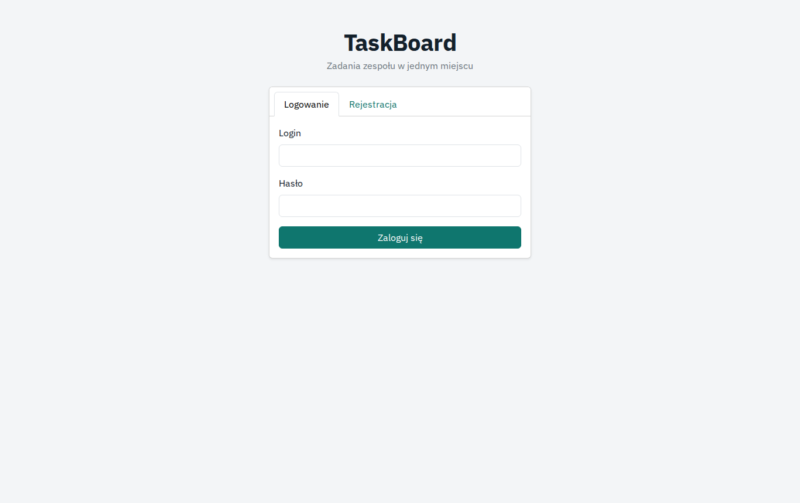
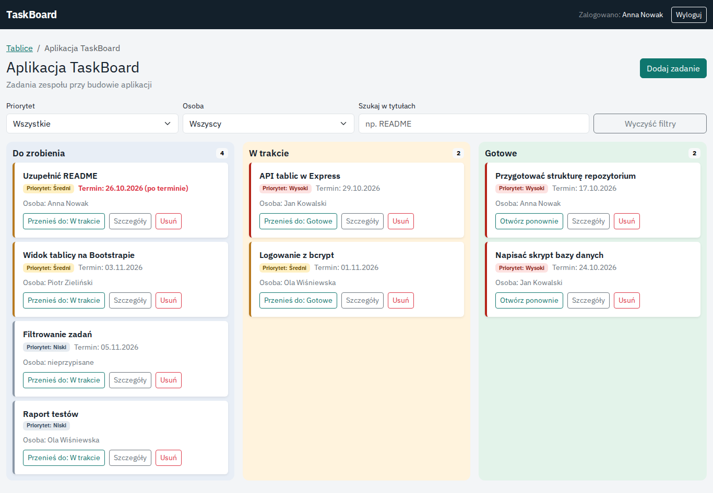

# TaskBoard

TaskBoard to aplikacja internetowa do zarządzania tablicami i zadaniami. Użytkownicy mogą się rejestrować i logować, tworzyć tablice, dodawać i edytować zadania, przypisywać je osobom, zmieniać status i filtrować wyniki.

## Technologie

- Frontend: HTML5, Bootstrap 5.3.3, własny CSS i JavaScript (Fetch API).
- Backend: Node.js 20+, Express 5, express-session, bcryptjs, mysql2, dotenv.
- Baza danych: MySQL 8.0+; hasła użytkowników jako hashe bcrypt.
- Narzędzia: Git, GitHub Actions, npm i przeglądarka z DevTools.

## Wymagane środowisko

- Node.js 20 lub nowszy i npm.
- MySQL Server 8.0 lub nowszy oraz klient poleceń mysql (albo MySQL Workbench).
- Przeglądarka z dostępem do Internetu (Bootstrap jest ładowany z CDN).
- Port 3000 dostępny lokalnie.

## Uruchomienie od zera

1. Sklonuj repozytorium i przejdź do projektu:

   ~~~sh
   git clone https://github.com/vmelnicuk88-wq/Taskboard-Vadym-Taran.git
   cd Taskboard-Vadym-Taran
   ~~~

2. Wykonaj pliki SQL w podanej kolejności (w terminalu bash lub cmd):

   ~~~sh
   mysql -u root -p < database/taskboard.sql
   mysql -u root -p taskboard < database/konta.sql
   ~~~

   Możesz także otworzyć oba skrypty w MySQL Workbench i uruchomić je kolejno.

3. Utwórz użytkownika aplikacji w konsoli MySQL (zmień przykładowe hasło):

   ~~~sql
   CREATE USER IF NOT EXISTS 'taskboard_app'@'127.0.0.1' IDENTIFIED BY 'lokalne_mocne_haslo';
   GRANT SELECT, INSERT, UPDATE, DELETE ON taskboard.* TO 'taskboard_app'@'127.0.0.1';
   ~~~

   Jeżeli konto już istnieje z innym hasłem, ustaw w pliku .env jego faktyczne dane.

4. Skopiuj przykładową konfigurację z głównego folderu: na Windows użyj polecenia copy, w bash cp.

   ~~~sh
   cp .env.example .env
   ~~~

   W pliku .env ustaw DB_HOST, DB_USER, DB_PASSWORD, DB_NAME=taskboard i długi, losowy SESSION_SECRET. Nie umieszczaj pliku .env w Git.

5. Zainstaluj zależności i uruchom serwer:

   ~~~sh
   cd backend
   npm install
   npm start
   ~~~

6. Otwórz http://localhost:3000/login.html, zaloguj się i sprawdź listę tablic. Możesz też zarejestrować nowe konto.

   Jeśli wystąpi błąd połączenia z bazą, sprawdź działanie MySQL, nazwę bazy i wartości w .env. API zdrowia: http://localhost:3000/api/health.

## Konta testowe

Skrypt database/konta.sql wprowadza pięć demonstracyjnych kont z pliku materialy/users.csv. Przykład: login **anna.nowak**, hasło **Test1234!**. Te dane są wyłącznie do lokalnych ćwiczeń, nie wolno używać ich na publicznym serwerze.

## Korzystanie z aplikacji

Po zalogowaniu strona boards.html pozwala tworzyć, otwierać, zmieniać i usuwać tablice. Na board.html zadania znajdują się w kolumnach Do zrobienia, W trakcie i Gotowe; przyciski otwierają szczegóły, edycję, zmianę statusu i usuwanie. Nad zadaniami można jednocześnie filtrować po priorytecie, osobie i fragmencie tytułu. Przyciskiem Wyloguj kończy się sesję. Trasy API poza logowaniem i rejestracją wymagają sesji.

## Testy i sprawdzenie projektu

W folderze backend uruchom npm test, aby uruchomić automatyczne testy łączonych filtrów. Scenariusze ręczne API i interfejsu są w docs/testy.md. Po starcie serwera sprawdź każdy plik HTML w W3C Nu Validator, a w DevTools uruchom Lighthouse w trybie Accessibility. Docelowy wynik to minimum 90 punktów na każdej stronie; nie wpisuj wyniku bez pomiaru. Sprawdź także telefon w trybie Responsive Design.

## Struktura projektu

| Folder | Odpowiedzialność |
| --- | --- |
| frontend/ | Strony HTML, style CSS i kod przeglądarkowy |
| backend/ | Serwer Express, sesje, API, testy i połączenie z bazą |
| database/ | Schemat SQL i szkoleniowe konta |
| docs/ | Model danych, lista zadań, dokumentacja API i raport testów |
| materialy/ | Materiały, makiety i przykłady przekazane na zajęciach |
| .github/ | Automatyczne kontrole projektu w GitHub Actions |

## Makiety i zrzuty referencyjne

Poniżej zamieszczono makiety dostarczone w materiałach (to **nie są** zrzuty działającej aplikacji). Rzeczywiste zrzuty z przeglądarki należy wykonać po lokalnym uruchomieniu z bazą danych.

## Materiały i autor

Wzory i pliki zajęciowe znajdują się w folderze materialy. Autor projektu: Vadym Taran.
