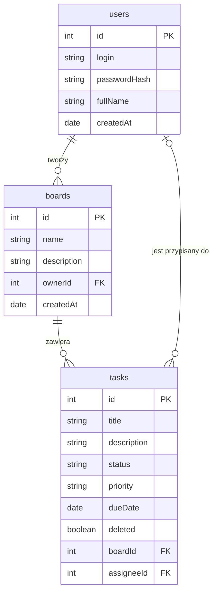

# Dane aplikacji TaskBoard

## Użytkownik

| Informacja | Przykład |
| --- | --- |
| Login | anna.kowalska |
| Hasło (zapisane jako hash, nie jawnie) | $2b$10$k3J... |
| Imię i nazwisko | Anna Kowalska |
| Data utworzenia konta | 2026-11-02 |

## Tablica

| Informacja | Przykład |
| --- | --- |
| Nazwa | Projekt TaskBoard |
| Opis | Zadania zespołu na demo |
| Właściciel (użytkownik, który ją utworzył) | anna.kowalska |
| Data utworzenia | 2026-11-02 |

## Zadanie

| Informacja | Przykład |
| --- | --- |
| Tytuł | Uzupełnić README |
| Opis | Dodać instrukcję uruchomienia |
| Status | todo / in_progress / done |
| Priorytet | low / medium / high |
| Termin | 2026-11-13 (opcjonalny) |
| Tablica, do której należy | Projekt TaskBoard |
| Przypisana osoba | anna.kowalska (opcjonalna) |
| Usunięte | false |

## Powiązania

Jeden użytkownik może utworzyć wiele tablic, a każda tablica ma dokładnie jednego właściciela.
Jedna tablica zawiera wiele zadań, a każde zadanie należy do dokładnie jednej tablicy.
Do jednego użytkownika może być przypisanych wiele zadań, a zadanie ma najwyżej jedną przypisaną osobę, więc przypisanie jest opcjonalne.
Hasła są zapisywane jako hash, a usunięte zadanie zostaje w bazie z flagą `deleted`, więc nie znika na zawsze.

## Przykład zadania w JSON

```json
{
  "id": 7,
  "title": "Uzupełnić README",
  "description": "Dodać instrukcję uruchomienia",
  "status": "in_progress",
  "priority": "high",
  "dueDate": "2026-11-13",
  "boardId": 2,
  "assigneeId": 1,
  "deleted": false
}
```

## Wstępny diagram ERD


